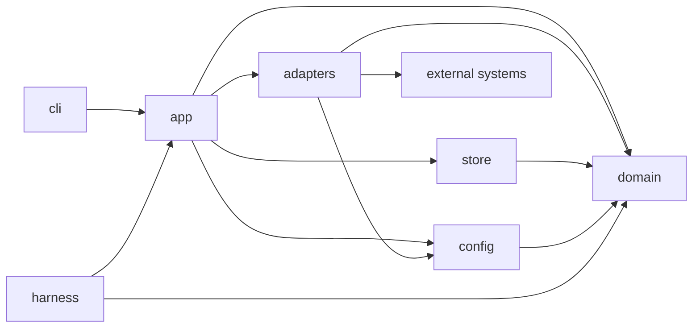
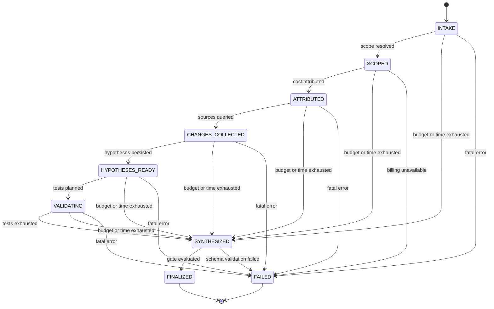
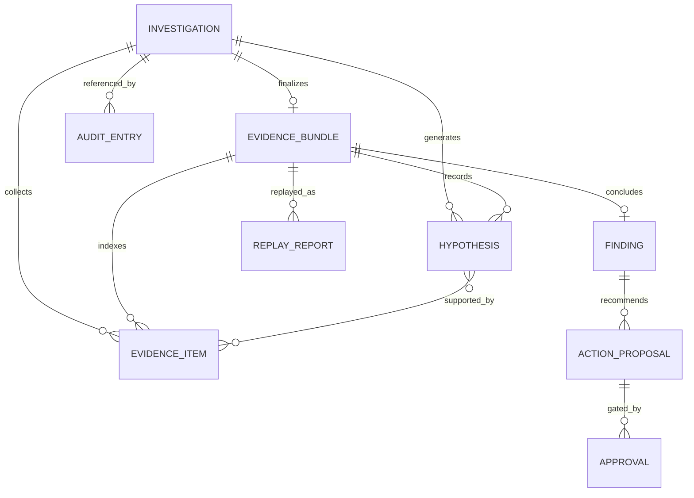
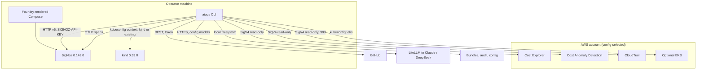

# Architecture Spine — AI Cloud Operations Platform

## Design Paradigm

**Hexagonal (ports and adapters), synchronous, single-process.**

The domain owns the Investigation: state, hypotheses, evidence rules, budget, and citation
gate. Every external system is an adapter behind a domain-owned port. The CLI is a thin shell
over one composition root and contains no business rules. The domain must run against fake
adapters; that is what makes replay, evaluation, and the budget testable without spending
money.



## Invariants & Rules

### AD-1 — The dependency rule is enforced by tooling

- **Binds:** all modules
- **Prevents:** an AWS SDK type, HTTP response, or framework object leaking into the domain;
  two builders choosing incompatible layering.
- **Rule:** `domain/` imports only the standard library, Pydantic, and `domain.*`.
  `domain/ports.py` defines every outward interface as a `typing.Protocol`. `adapters/`,
  `store/`, and `config/` may import `domain`; `domain` imports none of them. `adapters/` may
  import `config` types but never read env or TOML itself; resolved settings are injected at
  construction. `cli/` imports only `app/`. `app/` is the sole composition root. `import-linter`
  contracts in `pyproject.toml` enforce this in CI, and a violation fails the build. No adapter
  imports another adapter.

### AD-2 — Port contracts are fixed

- **Binds:** all ports; FR-1..FR-25
- **Prevents:** one adapter paginating internally while another expects the caller to; adapters
  minting evidence IDs; incompatible error and retry semantics.
- **Rule:** these are the only outward ports. Every method receives a `QueryPlan` or a domain
  value and returns the listed type; adapters never construct `evidence_id`, `payload_hash`, or
  any other domain identifier.

| Port | Method | Returns | Errors / notes |
| --- | --- | --- | --- |
| `BillingSource` | `query(plan) -> Page[CostRow \| AnomalyRow]` | one page per metered attempt | `SourceError`; unavailable is fatal. Covers Cost Explorer and Cost Anomaly Detection; the registry entry names the operation |
| `ObservabilitySource` | `query(plan) -> Page[TelemetryRow]` | one page per metered attempt | `SourceError(kind=no_data)` when the query is valid but empty |
| `ChangeSource` | `query(plan) -> Page[ChangeEvent]` | one page per metered attempt | `SourceError` |
| `OwnerResolver` | `resolve(scope) -> Owner` | `Owner` | never raises; returns `unowned` |
| `LLMClient` | `complete(role, prompt, schema) -> LLMResult` | text, parsed, usage, `cost_micros` | `LLMError`, `CostUnknown` |
| `ExportGateway` | `send(approval, payload) -> ExportReceipt` | receipt | `ApprovalError`, `ExportError` |
| `BundleStore` | `write_state`, `append_call`, `write_evidence`, `finalize`, `read` | typed records | `EvidenceCollision`, `ImmutableBundle` |
| `AuditLog` | `append(event) -> int` | global sequence | `AuditError` |
| `Tracer` | `span(name, attrs)` | context manager | never raises |
| `Clock` | `now() -> datetime` | UTC | injected |
| `IdGenerator` | `new(prefix) -> str` | domain ID | injected |
| `Rng` | `random() -> float` | `[0,1)` | injected |

`Page[T]` is `{items, next_cursor, has_more, cost_micros, page_index, cursor_in}`. The caller
paginates; adapters never loop. Each page becomes exactly one Evidence Item, so `page_index`
and `cursor_in` are recorded on the item and excluded from `evidence_id`. `Untrusted[T]` wraps
every adapter payload with source, query, window, and retrieval time, and is built exactly once
at the adapter boundary. Retry policy and rate limiting belong to `app`, not to adapters.

### AD-3 — The Evidence Bundle is the system of record

- **Binds:** FR-11, FR-12, FR-13, FR-17, FR-21, FR-22; UJ-2
- **Prevents:** conclusions that exist only in memory, logs, or a mutable checkpoint; replay that
  reconstructs state differently from the original run.
- **Rule:** `BundleStore.finalize(record)` is the sole writer of `bundle.json` and `report.md`.
  `bundle.json` has exactly these top-level members: `schema_version` (integer, `1`),
  `investigation_id`, `created_at`, `aiops_version`, `scope`, `cost_anomaly`, `changes`,
  `budget`, `config_provenance`, `sources`, `hypotheses`, `finding`, `owner`, `action_proposals`,
  `evidence_index`, `call_log`, `what_we_could_not_establish`, `registry_version`,
  `redaction_ruleset`, `trace_id`, `bundle_hash`. `evidence_index` is `list[str]` of Evidence
  Item IDs only; payloads live only in `evidence/`. `bundle_hash` is SHA-256 over the canonical
  bundle after removing `bundle_hash` entirely. `report.md` renders from the post-gate bundle,
  so Markdown and JSON cannot diverge. After finalization, `bundle.json`, `report.md`, and
  `evidence/` are immutable.

  Finalization is ordered so that no crash produces an unresumable or unrendered state:
  write `report.md.tmp`, write and `os.replace` `bundle.json`, rename `report.md.tmp` to
  `report.md`, then the orchestrator writes `state.json` with `terminal=true` through
  `BundleStore.write_state`. The presence of `bundle.json` is the authoritative terminal check,
  not the flag; a crash before `bundle.json` leaves the investigation resumable. A crash after
  it is recovered by rendering `report.md` and writing terminal `state.json` from the existing
  bundle; `bundle.json` is never rewritten.

  `state.json` is the complete resumable checkpoint: state, outcome, stop_reason, scope,
  ledger (LLM spend, cloud-API spend, elapsed, attempt count), deadline, `sources` status,
  call-log path, hypotheses, evidence index, effective budget, config provenance, `trace_id`,
  and `terminal`. Resume restores the ledger and remaining wall clock from `state.json` and
  re-applies any `budget.json` override. Resume is legal only when `bundle.json` does not
  exist; otherwise the run is a new Investigation with a new `investigation_id`. A finalized
  bundle is never overwritten.

  Member shapes are fixed: `budget` is the ledger snapshot (`limits`, `llm_spent_micros`,
  `cloud_spent_micros`, `elapsed_ms`, `attempts`); `config_provenance` is the EffectiveConfig
  map from AD-11; `sources` is `{source_family: {status, reason?, gate}}`; `call_log` mirrors
  `call_log.jsonl`; `what_we_could_not_establish` is `list[str]`.

### AD-4 — Evidence identity is content-addressed and canonically serialized

- **Binds:** FR-12, FR-13, FR-25; SM-2, SM-5
- **Prevents:** the same observation hashing differently across adapters; citations surviving a
  silent data change; adapter-specific metadata changing identity.
- **Rule:** `domain/primitives.py` owns `Window`, `Money`, `canonical_json`, `sha256_hex`,
  `normalize_payload`, and `new_id`. Canonical JSON is RFC 8785 JCS with floats forbidden:
  money is integer micro-USD, percentages are basis points, timestamps are RFC 3339 UTC
  truncated to whole seconds, strings are NFC-normalized, and arrays preserve provider order
  unless the registry entry names a sort key. `Window` is `{start, end, granularity}` with an
  end-exclusive UTC boundary.

  `payload_hash = sha256_hex(canonical_json(normalize_payload(plan, redacted_payload)))`, where
  normalization projects the provider response through the query's `PayloadModel` and drops
  request IDs, headers, and pagination tokens. `evidence_id = "ev-" +
  sha256(canonical_json({source_family, query_id, query, window, payload_hash}))[:32]` — 128
  bits. `query` is the validated params dict, not the provider request body. `retrieved_at`,
  `reference`, `source_refs`, `page_index`, `cursor_in`, and `redaction_ruleset` are stored on
  the item but excluded from the ID preimage. If an evidence file for an ID exists with a
  different `payload_hash`, raise `EvidenceCollision`; never overwrite.

  `Window.granularity` is one of `minute`, `hour`, `day`, `month`. Floats never appear in
  persisted or hashed data: any numeric value that is not money or a percentage is declared by
  its `PayloadModel` as an integer unit (milliseconds, bytes, counts, basis points) before
  canonicalization. Redaction rulesets are append-only and their IDs are immutable; the
  ruleset recorded on an Evidence Item is the one applied when it was created.

### AD-5 — One budget ledger meters every billable attempt

- **Binds:** FR-3, FR-21; SM-3; §6.3
- **Prevents:** a retry or pagination loop bypassing accounting; a $1.00 ceiling crossed while
  the bundle reports success; two modules pricing the same request differently.
- **Rule:** `domain.budget.BudgetLedger` is the only spend state. One metered call equals one
  SDK or HTTP attempt; retries and pagination re-enter it, so a five-page Cost Explorer read is
  five metered calls. `app.call(...)` checks the ledger before dispatch and records actual cost
  after. A check raises `BudgetExhausted` before any request is sent. Per-call timeout is
  `min(30s, remaining wall clock)`; at most two retries for idempotent reads, each preceded by
  a backoff honouring the registry's rate limit; every attempt is recorded. LLM calls use
  `num_retries=0`.

  The price table in config is keyed by metered operation: `ce:GetCostAndUsage` and
  `ce:GetCostForecast` are `10,000` micro-USD (that is, `$0.01`) per request per billing view;
  `ce:GetAnomalies`, `ce:GetDimensionValues`, and every `free` cost-class query are explicitly
  `0`. There is no implicit default: an unlisted metered operation fails closed with
  `ConfigError`. LLM cost is converted from LiteLLM's response cost with `Decimal(str(cost))`,
  `ROUND_HALF_UP`, negatives clamped, and returned as `cost_micros: int`. The lookup key
  is LiteLLM's provider-prefixed model-map key (`anthropic/...`, `deepseek/...`), never the bare
  `response.model`. A missing cost raises `CostUnknown`, which stops all further dispatch; the
  run transitions to `SYNTHESIZED` with `outcome=partial` and `stop_reason=budget_exhausted` —
  never `FAILED`. A local model must declare an explicit price, including `0`. Money is integer
  micro-USD everywhere; no floats in persisted data. `budget.json` in the investigation
  directory holds the limits and is re-read at every check, so
  `aiops budget set <inv-id> --max-usd` takes effect immediately and is audited.

### AD-6 — Execution is synchronous and deterministic

- **Binds:** all; FR-13, FR-16, FR-21, FR-25
- **Prevents:** parallel tool calls racing the budget; replay diverging because ordering,
  timestamps, IDs, or sampling were uncontrolled.
- **Rule:** no `asyncio`, no thread pools, no parallel tool calls in v1. One call at a time, in
  the recorded order. Domain code never calls `datetime.now()`, `uuid4()`, or `random` directly;
  it receives `Clock`, `IdGenerator`, and `Rng` from `domain.ports`. Sampling parameters are
  never emitted for `anthropic/*` models: Sonnet 5.5 rejects `temperature`, `top_p`, and
  `top_k` with a 400, and LiteLLM's `supported_openai_params` is not a reliable gate because it
  advertises them anyway. Do not rely on `drop_params=True`. A regression test asserts that no
  sampling key reaches the request body for any shipped default. Determinism comes from recorded
  prompts, recorded outputs, and replay, not from a forced temperature. A `--live` evaluation is
  allowed to vary and must report its range.

### AD-7 — The Investigation state machine is explicit, closed, and total

- **Binds:** FR-1, FR-2, FR-3, FR-15, FR-16, FR-17
- **Prevents:** an implicit path to "done"; budget exhaustion producing an artifact shape the
  bundle cannot represent; a state/outcome combination no writer handles.
- **Rule:** only transitions in `domain.state.TRANSITIONS` are legal; anything else raises
  `InvalidTransition`. Every transition checks the Budget Guard except `SYNTHESIZED → FINALIZED`,
  which is a write, not a dispatch. Exhaustion from any active state goes to `SYNTHESIZED` with
  `outcome=partial`. Hypotheses are persisted in `HYPOTHESES_READY` before any test runs.
  `FINALIZED` and `FAILED` are immutable.

  `outcome` is orthogonal to state and is one of `finding`, `inconclusive`, `partial` (`null`
  only when the state is `FAILED`).
  `stop_reason` is one of `complete`, `source_degraded`, `budget_exhausted`, `time_exhausted`,
  `fatal`. The mapping is mechanical: any `budget_exhausted` or `time_exhausted` gives
  `partial`; otherwise a supported Finding gives `finding`; otherwise an unavailable source
  gives `partial`; otherwise `inconclusive`. `no_data` is not degraded: a valid empty
  query yields `kind=observation`, `source_status=ok`, `payload={"no_data": true}` and remains
  citable. `FAILED` has `outcome=null`, `stop_reason=fatal`, and writes only `state.json` and
  audit — no bundle.



### AD-8 — Models may only choose from a registered query catalogue

- **Binds:** FR-7, FR-9, FR-12, FR-15, FR-16; §6.1
- **Prevents:** a prompt-injected log line steering the agent into an arbitrary query or outbound
  request; LLM-authored SQL or PromQL that cannot be replayed.
- **Rule:** every external data read is a `QueryPlan(query_id, params)` from
  `domain.queries.REGISTRY`. Each entry declares `source_family` (`billing`, `observability`,
  `change_aws`, `change_git`, `change_k8s`, `owner`, `config`), a Pydantic params schema, a
  `PayloadModel`, a cost class (`free`, `metered_ce`, `metered_other`), a `retention_hint_days`,
  and whether a golden fixture is required. Price lives only in the config table; the registry
  never carries a dollar amount. An LLM may select a `query_id` and fill typed params; it may
  not emit a query string. Unknown IDs and invalid params are rejected before dispatch.

  The registry is append-only. Removing a query marks it `deprecated: true` and retains it for
  at least the longest bundle retention. Adding an entry requires a golden fixture and a
  params-schema test. `retention_hint_days` is copied into the Evidence Item at collection and
  never re-read. `source_family`, not adapter name, is the unit of source independence.

  Registry entries also carry the provider's hard limits, which `app` enforces: the
  `change_aws` CloudTrail entry declares 50 results per page and 2 requests per second per
  account per region, and Cost Explorer entries declare one request per page with no batching.
  A throttle response backs off and re-enters the budget ledger; the rate limit is never
  exceeded, even across retries.

### AD-9 — Replay never re-synthesizes and never claims a live result it did not get

- **Binds:** FR-13; SM-5; UJ-2
- **Prevents:** replay spending money or drifting because a model was called again; expired
  evidence being reported as a successful live replay.
- **Rule:** `aiops replay <bundle>` performs zero LLM calls. It re-executes each recorded
  `QueryPlan` using the Redaction Ruleset recorded on the original Evidence Item; a retired or
  unavailable ruleset resolves to `snapshot_only` rather than re-hashing with current rules. It
  compares `payload_hash` and writes exactly one `replays/<timestamp>-<n>/replay.json` plus
  `replays/<timestamp>-<n>/evidence/` for drift items. `ReplayReport` contains
  `source_bundle_sha256`, `results` (one per Evidence Item with `evidence_id`, `status`,
  `payload_hash_before`, `payload_hash_after`, optional `new_evidence_id`), `citation_gate`, and
  `schema_valid`. Status is `identical`, `drift`, `snapshot_only`, or `unavailable`. An unknown,
  deprecated, or retention-expired query resolves to `snapshot_only`, never an error. `new_evidence_id`
  names a file written under `replays/<timestamp>-<n>/evidence/` with `kind=drift`; it is never
  added to the original bundle. The original bundle is never mutated.

  The citation gate is re-run only over the original Evidence Items. A cited item whose replay
  status is `drift` costs one confidence level; only a drift that contradicts the cited claim
  downgrades the replayed Finding to `inconclusive`. Undrifted citations survive unchanged.
  `--snapshot-only` performs no re-execution, makes no network call, and marks every result
  `snapshot_only`.

### AD-10 — LLM routing is role-based, config-driven, and fail-closed

- **Binds:** FR-8, FR-15, FR-17; §8
- **Prevents:** hardcoded model IDs going stale; one module calling a provider directly while
  another uses LiteLLM; `local-only` leaking a request to a cloud provider.
- **Rule:** the only LLM port is `LLMClient.complete(role, prompt, schema)`, with roles
  `planner`, `extractor`, `synthesizer`, and `judge`. Role → provider/model mapping lives in
  config. Shipped defaults: planner and synthesizer `anthropic/claude-sonnet-5-5`, extractor
  `deepseek/deepseek-flash`, judge `deepseek/deepseek-v4-pro`. `llm.mode = "local-only"`
  overrides every role to the configured local model and disables cloud LLM egress; it does not
  fall back. `aiops doctor` validates every model against LiteLLM's local model map without a
  provider call and fails closed on an unknown ID. No adapter other than `adapters/llm/` may
  import LiteLLM. Credentials never enter a prompt; they are injected at the tool boundary.

### AD-11 — Config precedence is fixed, and project config cannot widen scope

- **Binds:** FR-1, FR-23; §6.2, §7
- **Prevents:** a cloned repository redirecting telemetry, selecting another cluster, or raising
  the budget; secrets committed to disk; silent profile fallback to an unintended account.
- **Rule:** precedence is `defaults < project aiops.toml < user config < AIOPS_* env < CLI`.
  Project config may set only `project.name`, `github.repo`, `kubernetes.namespace`, and
  `eval.scenario_dir`. Every endpoint, credential, cluster context, account, region, model, and
  budget value is user/env/CLI only. `config.resolve()` is the sole producer of an
  `EffectiveConfig` mapping each key to `{value, source, trust}`; `settings.py` is a typed view
  over it. The map is recorded in `bundle.json`. Secrets come only from environment variables or
  the OS keyring. A locked, unavailable, or headless keyring falls through to environment
  variables; a secret that resolves nowhere maps to `SourceError(kind=not_configured)` for that
  source, never a crash. AWS auth uses the boto3 default chain with an explicit `profile` or
  `role_arn`; `account_id` and `region` are required and asserted against
  `sts:GetCallerIdentity`.

### AD-12 — Every command passes the read-only gate for the sources it will read

- **Binds:** FR-23; §6.1, §7
- **Prevents:** discovering mid-investigation that the role can terminate instances; running
  under the wrong account; an offline replay being blocked by a network-only check.
- **Rule:** `aiops doctor` owns config validation, identity assertion, and per-source
  reachability. For AWS it resolves the underlying IAM role ARN from
  `GetCallerIdentity`'s assumed-role ARN because `PolicySourceArn` rejects assumed-role ARNs,
  then calls `iam:SimulatePrincipalPolicy` with the versioned concrete action list in
  `config/readonly_actions.toml` and explicit `ResourceArns` (never the `*` default). It fails
  closed when any action evaluates to `allowed`, when `MissingContextValues` is non-empty, or
  when the simulation call itself returns `AccessDenied`; a normal `implicitDeny` or
  `explicitDeny` decision is the expected pass. The action list is enumerated by a test, not a
  wildcard.

  Kubernetes is checked with `SelfSubjectAccessReview` for create, update, patch, and delete.
  GitHub `X-OAuth-Scopes` proves grants for classic and OAuth tokens and is recorded as
  `verified`. Fine-grained tokens expose only the repository `permissions` role (`admin`,
  `maintain`, `push`, `triage`, `pull`), which cannot prove `issues:write`; every fine-grained
  check is recorded as `best-effort` and requires approval at export time.

  The gate is scoped by what will actually be contacted, not by command name:

  | Command | Gate |
  | --- | --- |
  | `investigate` | AWS iff any AWS adapter is live; plus each configured SigNoz, GitHub, and Kubernetes source |
  | `export` | GitHub only |
  | `replay` | each source family present in the bundle, because it re-executes live; `replay --snapshot-only` gates none and records `gate: offline` |
  | `eval` (fixture) | none; records `gate: offline` |
  | `eval --live` | identical to `investigate` |

  A fixture `BillingSource` therefore needs no AWS credentials. Results are cached by
  `sha256(caller_arn + account_id + region + kube_context_uid + github_token_id)` for 15
  minutes and store the resolved identity, not just pass/fail. There is no bypass flag.

### AD-13 — Durable writes are atomic, owned, and auditable

- **Binds:** FR-13, FR-21, FR-22
- **Prevents:** half-written bundles after a crash; two processes forking the audit hash chain;
  an audit entry that can be quietly rewritten.
- **Rule:** data root is `platformdirs.user_data_dir("aiops")`, overridable by `AIOPS_HOME` or
  `--out`. Writes go to a temp file in the same directory, then `fsync`, then `os.replace`. One
  `filelock` per investigation. The audit log takes a single global
  `audit/audit.jsonl.lock` across read-head → hash → append → `fsync`. `seq` is globally
  monotonic; genesis `prev_hash` is 64 zeros; `entry_hash` is excluded from the hashed object;
  `entry_hash = sha256(prev_hash + canonical_json(entry))`. The verifier is a pure function with
  a fixed test vector. Audit entries live outside the investigation directory and survive
  bundle deletion. No CLI command rewrites or deletes the log. The resolved data root, including
  whether it came from `--out`, `AIOPS_HOME`, or the platform default, is recorded in
  `config_provenance`.

Artifact ownership:

| Path | Sole writer | Mutability |
| --- | --- | --- |
| `investigations/<id>/state.json` | orchestrator | until terminal |
| `investigations/<id>/budget.json` | `aiops budget set` | mutable, audited |
| `investigations/<id>/call_log.jsonl` | `app.call` | append-only |
| `investigations/<id>/evidence/<ev>.json` | `BundleStore` | write-once |
| `investigations/<id>/approvals/ap-<proposal_n>-<approval_seq>.json` | `ExportGateway` | write-once |
| `investigations/<id>/bundle.json` | `BundleStore.finalize` | immutable |
| `investigations/<id>/report.md` | `BundleStore.finalize` | immutable |
| `investigations/<id>/replays/<ts>-<n>/` | `ReplayRunner` | write-once |
| `audit/audit.jsonl` | `AuditLog` | append-only, global lock |
| `cache/<source>/<hash>.json` | adapters | mutable, never evidence |
| `eval/results/<run>/` | `EvalRunner` | write-once |

### AD-14 — The domain schema is closed and glossary-complete

- **Binds:** FR-2, FR-4..FR-8, FR-14, FR-18, FR-19; glossary
- **Prevents:** five builders inventing five shapes for the same PRD term; a report that cannot
  represent `unowned`, `unknown`, a ruled-out change, or a cost range.
- **Rule:** these Pydantic models are the only persisted shapes; `extra="forbid"` everywhere.
  `Finding`, `Hypothesis`, `EvidenceItem`, and `Bundle` are further constrained by AD-3, AD-4,
  and AD-15.

| Model | Required members |
| --- | --- |
| `CostAnomaly` | `anomaly_id?`, `account_id`, `service`, `resource_set[]`, `dimension`, `baseline_window`, `observed_window`, `delta_micros`, `scope_level` (`account`, `service`, `resource`) |
| `ChangeEvent` | `change_id`, `occurred_at`, `actor`, `source_family`, `source_ref` (replayable), `summary`, `resources[]`, `merged_refs[]`, `status` (`candidate`, `corroborated`, `ruled_out`), `rule_out_reason?` |
| `CostImpactEstimate` | `low_micros`, `high_micros`, `assumptions[]`, `window`, `confidence`, `weak_extrapolation: bool` |
| `Owner` | `team`, `source` (`tag`, `codeowners`, `mapping`, `unowned`), `contact?` |
| `Claim` | `kind` (`cause`, `attribution`, `telemetry`, `change`), `text`, `evidence_ids[]` |
| `Hypothesis` | `hypothesis_id`, `statement`, `test: QueryPlan`, `status` (`pending`, `confirmed`, `refuted`, `unresolved`), `evidence_ids[]` |
| `Finding` | `outcome`, `summary`, `claims[]`, `confidence`, `rationale`, `unresolved[]`, `cost_impact: CostImpactEstimate \| null` |
| `ActionProposal` | `proposal_id`, `title`, `change`, `risk` (`low`, `medium`, `high`), `blast_radius` (`accounts`, `services`, `resources`, `users`), `savings_micros` or `null`, `savings_note`, `verification`, `evidence_ids[]` |
| `EvidenceItem` | `evidence_id`, `schema_version`, `kind` (`observation`, `source_unavailable`, `drift`, `injection_signal`, `redaction_failed`), `source_family`, `source_status` (`ok`, `degraded`, `unavailable`), `source_refs[]`, `query_id?`, `query?`, `window?`, `page_index?`, `cursor_in?`, `retrieved_at`, `payload?`, `payload_hash?`, `reference?`, `redaction_ruleset`, `retention_hint_days?` |

`Bundle` (AD-3), `Approval` (AD-17), `AuditEntry` (AD-13), `ReplayReport` (AD-9), and
`RunRecord` (AD-20) are the only other persisted shapes, each with the single writer named in
AD-13.

Duplicate Change Events across sources merge into one record with every `source_ref` retained
in `merged_refs`; a ruled-out candidate keeps its disqualifying evidence. Unknown savings is
`savings_micros: null` plus `savings_note: "unknown"`, never an invented number.

### AD-15 — Findings pass a citation gate before they can be rendered

- **Binds:** FR-11, FR-14, FR-17, FR-19; SM-2
- **Prevents:** fluent prose with no evidence; a high-confidence claim resting on one source; a
  missing source being counted as corroboration; Markdown and JSON disagreeing.
- **Rule:** the synthesizer emits a structured `Finding` whose claims each carry a non-empty
  `evidence_ids` list. Only `EvidenceItem.kind = observation` with `source_status` `ok` or
  `degraded` may be cited; `source_unavailable`, `drift`, `injection_signal`, and
  `redaction_failed` items are context, not support. Unknown IDs and empty lists downgrade the
  outcome to `inconclusive`; they never fail the run.

  Confidence is capped mechanically. Independence is the number of distinct `source_family`
  values among cited items; a merged ChangeEvent contributes only its primary family no matter
  how many `source_refs` it retains, so one change seen by CloudTrail, GitHub, and Kubernetes is
  one occurrence, not three. `high` requires at least two distinct families corroborating the
  same claim and no open contradiction; `medium` requires at least one family and no
  contradiction; `low` covers one family with an unresolved test, a contradiction, or a
  material gap. A `degraded` citation adds an entry to `unresolved[]`. Any contradiction
  downgrades one level. The report contains a non-empty "What we could not establish" section
  whenever a source is unavailable, a Hypothesis is unresolved, or a contradiction exists.
  Every Action Proposal cites the evidence that justifies it. Markdown is rendered from the
  validated bundle; there is no free-text path to the report.

### AD-16 — Failures are typed, isolated, and visible

- **Binds:** FR-7, FR-9, FR-14; §5 failure isolation
- **Prevents:** one flaky source aborting an investigation; a missing source reported as "no
  change"; inconsistent exit codes across commands.
- **Rule:** adapters raise `SourceError(kind, source, retryable, detail)` with `kind` in
  `auth`, `throttle`, `timeout`, `bad_response`, `retention_expired`, `no_data`,
  `not_configured`. The orchestrator records a `source_unavailable` Evidence Item and continues
  for every kind except `no_data`; the source is reported as `ok`, `degraded`, or `unavailable`.
  `no_data` records an observation with `payload={"no_data": true}`. Only `BillingSource`
  failure is fatal. Exit codes: `0` report written (including `partial`, `inconclusive`, and a
  run stopped by `CostUnknown` or `no_data`), `2` usage/config or gate refusal, `3` fatal source
  or schema failure with no report, `4` internal error, `5` invariant violation
  (`InvalidTransition`, `EvidenceCollision`, canonicalization failure), `6` approval refused or
  payload-hash mismatch. Every error carries a stable `AIOPS-<AREA>-<NNN>` code.

### AD-17 — No outward mutation except through the Approval Gate

- **Binds:** FR-19, FR-20; UJ-3; §6.1
- **Prevents:** a model or adapter posting a draft before a human approves it; an approval
  covering a payload that later changed; a security reviewer reading the rule as "no data
  leaves the machine".
- **Rule:** `ExportGateway` is the only outward-writing port. `domain.canonical.render_export`
  returns the exact UTF-8 `bytes` payload; nothing downstream re-encodes it. It requires an
  `Approval` record with actor, timestamp, and `sha256_hex(payload_bytes)`, and re-hashes those
  same bytes immediately before sending; a mismatch aborts with exit `6`. Approvals are stored
  write-once at
  `investigations/<id>/approvals/ap-<proposal_n>-<approval_seq>.json` and mirrored to audit;
  re-approval after a payload change adds the next `approval_seq` rather than overwriting.
  `approvals/` is outside bundle immutability. The adapter sends the approved bytes verbatim and
  may add only transport headers, which are excluded from the payload hash.

Egress is governed separately from mutation:

| Egress | Path | Precondition |
| --- | --- | --- |
| AWS reads | SigV4, boto3 | read-only gate (AD-12) |
| SigNoz reads | HTTP v5 | configured endpoint |
| GitHub reads | REST | read-scoped token |
| LLM prompts | LiteLLM | redaction applied (AD-18); `local-only` disables |
| OTLP spans | HTTP | redaction, opt-in |
| GitHub issue/PR draft | `ExportGateway` | Approval |

### AD-18 — Redaction precedes every outbound payload and persisted artifact

- **Binds:** §6.2; FR-12, FR-21
- **Prevents:** secrets or raw production logs reaching a model, a bundle, a trace, or the audit
  log; three modules applying three redaction rules.
- **Rule:** `domain.redact.apply(payload, ruleset_id)` is the only transformer. It runs before
  any LLM prompt, bundle write, audit write, log line, or span export. `redaction_ruleset` is
  stored on every Evidence Item. A payload that cannot be safely redacted is refused and
  recorded as `redaction_failed`; it is never sent or persisted raw. Credentials are injected at
  the tool boundary and never enter LLM context. `local-only` is the fallback when external
  processing is not permitted.

### AD-19 — Infrastructure ownership is split, with no overlap

- **Binds:** §8, §10
- **Prevents:** Terraform managing local containers; two sources of truth for local SigNoz; a
  demo that requires cloud infrastructure to start.
- **Rule:** `infra/terraform/` provisions AWS only (VPC, optional EKS, read-only IAM role,
  CUR-ready S3) and uses only the `aws` provider. `infra/signoz/` holds `casting.yaml`,
  `casting.yaml.lock`, and the Compose files rendered by `foundryctl forge` into
  `pours/deployment/`, vendored so setup does not require Foundry at runtime; regeneration is a
  documented upgrade step. `infra/k8s/` holds optional Helm values only. Terraform never manages
  local Docker; Compose never creates AWS resources. A contract test asserts the provider list
  and the vendored hash. The default demo uses a fixture `BillingSource` plus `kind` plus local
  SigNoz at zero AWS cost; the live demo spends roughly `$0.10` on Cost Explorer.

### AD-20 — The evaluation harness is hermetic, injectable, and pre-registered

- **Binds:** FR-24, FR-25; SM-1..SM-6
- **Prevents:** an eval that quietly spends money; ground truth edited after seeing results; a
  scenario that errors being dropped from the denominator; an eval importing adapters directly.
- **Rule:** `app.build(mode=Live | Fixture(dir) | Replay(bundle))` is the only construction API.
  `Replay(bundle)` is a bundle-backed fixture: it reads recorded evidence and never re-executes
  a query or touches the network.
  Fixtures are `fixtures/<query_id>.json` payloads plus the exact `Window`, hashed by the same
  canonical rules as live evidence, and declare `cost_micros` for modeled spend. In `Fixture`
  mode `Page.cost_micros` is always `0` and never touches the ledger; the declared amount is
  recorded on the run as `modeled_cost_micros` only, so fixture runs cannot exhaust the Budget
  Guard or deflate SM-1. Default eval mode is `Fixture` with zero network and zero spend;
  `--live` is explicit and is the only mode that measures SM-3's real spend. Results go to
  `eval/results/<git-sha>-<timestamp>/` with per-run files and a `summary.json`; metrics report
  mean and range across at least three runs, and range `0` is a valid deterministic outcome.

  Scenarios live in `eval/scenarios/<id>/` with `scenario.yaml`, `ground_truth.yaml`, and
  `fixtures/`; the suite holds 15–25 scenarios plus 5 replayed postmortems. `aiops eval lock`
  writes `{ground_truth_sha256, git_sha}` and refuses on a dirty tree; the runner verifies the
  hash and commits before results. A scenario that errors counts as a failure. Metrics are
  computed in code, not by an LLM, except the secondary citation judge.

### AD-21 — The system traces itself into SigNoz, and tracing never breaks a run

- **Binds:** FR-21; §5
- **Prevents:** a tracing outage failing an investigation; vendor-specific span names spreading
  through the codebase.
- **Rule:** one OTel span per state transition, query attempt, and LLM call, named
  `aiops.<area>.<operation>`, with attributes under `aiops.*`. `trace_id` is allocated at
  `INTAKE`, stored in `state.json`, and copied into the bundle; finalization does not allocate a
  new one. Redaction runs before export. Exporter failure is logged and swallowed; the local
  call log and audit log remain the source of truth. Tracing is opt-in.

## Consistency Conventions

| Concern | Convention |
| --- | --- |
| Module naming | Singular nouns: `domain`, `store`, `config`; ports end in `Source`, `Resolver`, `Client`, `Gateway`; adapter classes use `Aws*`, `SigNoz*`, `GitHub*`, `K8s*`, `LiteLLM*`; files may be narrower than classes (`ce.py` holds `AwsCostExplorerSource`) |
| Schema module | `domain/models.py` is the one place multiple public models may live; every other module exposes one public class |
| Identifiers | `inv-YYYYMMDDTHHMMSSZ-<6hex>`; `ev-<sha256[:32]>`; `hyp-<n>`; `ap-<proposal_n>-<approval_seq>`; audit `seq` is global |
| Money | Integer micro-USD (`*_micros`); USD only; no floats in persisted or hashed data |
| Dates | RFC 3339 UTC with `Z`; seconds in IDs and hashed payloads, milliseconds in logs and audit |
| Hash | SHA-256, lowercase hex; canonical JSON per AD-4; `sha256:` prefix only in prose |
| Evidence kinds | `observation`, `source_unavailable`, `drift`, `injection_signal`, `redaction_failed` |
| Source status | `ok`, `degraded`, `unavailable` (never `partial`, which is an outcome) |
| Errors | `{"error": {"code": "AIOPS-<AREA>-<NNN>", "message": "...", "details": {}}}` on stderr |
| State mutation | Domain transitions are the only mutation path; adapters are stateless; stores write atomically |
| Config | TOML; `AIOPS_` env prefix; secrets only from env/keyring; provenance recorded |
| Logging | `structlog` JSON to stderr; redaction before write; never log secrets |
| Tests | Domain unit tests with fakes; adapters against `moto`/`respx`; one contract test per port; eval is the end-to-end test |

## Stack

| Name | Version |
| --- | --- |
| Python | 3.14.10, pinned in `.python-version` (`requires-python = ">=3.12,<3.15"`; LiteLLM caps at `<3.15`) |
| uv | 0.13.6 (minimum 0.13.6 — earlier versions cannot install 3.14.10) |
| Typer / Rich | 0.27.3 / 15.0.0 |
| Pydantic / pydantic-settings | 2.14.1 / 2.16.2 |
| LiteLLM | 1.106.6 |
| boto3 / botocore | 1.43.121 |
| httpx / tenacity | 0.28.1 / 9.2.1 |
| jsonschema | 4.26.0 |
| opentelemetry-sdk / exporter-otlp | 1.45.1 |
| kubernetes (Python client) | 37.0.1 |
| structlog | 26.1.0 |
| platformdirs / filelock / keyring | 4.14.0 / 3.32.7 / 25.7.0 |
| pytest / pytest-cov / moto / respx | 9.2.0 / 7.1.0 / 5.2.5 / 0.23.1 |
| ruff / mypy / import-linter | 0.17.3 / 2.4.1 / 2.15 |
| SigNoz | 0.148.0, HTTP API `/api/v5/query_range`, `SIGNOZ-API-KEY` |
| Foundry (regeneration only) / kind | 0.4.0 / 0.33.0 |
| Terraform / AWS provider / EKS module | 1.17.1 / 6.71.0 / 21.29.0 |

All versions verified 2026-10-29 against PyPI, GitHub releases, endoflife.date, and vendor
docs; the audit trail is in `.memlog.md`. `filelock` is pinned below 4.0 because LiteLLM
1.106.6 requires it.

## Structural Seed

```text
ai-cloud-ops/
  pyproject.toml
  .python-version             # 3.14.10
  aiops.toml                  # project-scope config only (AD-11)
  src/aiops/
    cli/                      # investigate, replay, export, eval, doctor, config, budget
    app/                      # build(), orchestrator, call(), metered_call, export
    domain/
      primitives.py           # Window, Money, canonical_json, normalize_payload, ids
      models.py               # AD-14 models + Bundle
      state.py                # states, TRANSITIONS, outcome mapping
      budget.py               # BudgetLedger
      queries.py              # QueryPlan registry
      citation.py             # citation gate, confidence cap
      redact.py               # ruleset application
      canonical.py            # render_export
      ports.py                # AD-2 protocols
    adapters/
      aws/                    # ce.py, cloudtrail.py, sts.py, iam.py
      signoz/                 # client.py
      github/                 # rest.py
      k8s/                    # rollouts.py, owners.py
      llm/                    # router.py
    store/                    # bundles.py, audit.py, locks.py
    config/                   # settings.py, precedence.py, readonly_actions.toml
    harness/                  # runner.py, metrics.py (code; data lives in eval/)
  infra/
    terraform/                # vpc, optional eks, read-only iam, cur s3
    signoz/                   # casting.yaml, casting.yaml.lock, pours/deployment/
    k8s/                      # optional helm values
  eval/
    scenarios/<id>/           # scenario.yaml, ground_truth.yaml, fixtures/
    ground-truth.lock
    results/
  tests/
    unit/ contract/ integration/ e2e/
  docs/
```

The four empty stubs — `src/aiops/agent.py`, `src/aiops/state.py`,
`src/aiops/tools/observability.py`, and `tests/test_agent.py` — are superseded by this tree.
Remove those four files only when the first story lands; `src/aiops/state.py` is not
`src/aiops/domain/state.py`.

### Core entities



### Deployment and environments

Process view only; dependencies follow AD-1.



## Capability → Architecture Map

| Capability / Area | Lives in | Governed by |
| --- | --- | --- |
| FR-1..FR-3 intake and Budget Guard | `domain/state.py`, `domain/budget.py`, `app/orchestrator.py` | AD-5, AD-6, AD-7, AD-11 |
| FR-4..FR-6 cost attribution and impact | `adapters/aws/ce.py`, `domain/queries.py`, `domain/models.py` | AD-4, AD-5, AD-8, AD-14 |
| FR-7..FR-8 change correlation | `adapters/aws/cloudtrail.py`, `adapters/github/`, `adapters/k8s/` | AD-4, AD-8, AD-14, AD-16 |
| FR-9..FR-10 telemetry correlation | `adapters/signoz/client.py` | AD-4, AD-8, AD-16 |
| FR-11..FR-14 evidence, citation, replay | `domain/models.py`, `domain/citation.py`, `store/bundles.py` | AD-3, AD-4, AD-9, AD-15 |
| FR-15..FR-17 hypotheses and report | `domain/state.py`, `adapters/llm/router.py`, `store/bundles.py` | AD-7, AD-8, AD-10, AD-15 |
| FR-18 owner resolution | `adapters/k8s/owners.py`, `adapters/github/rest.py`, `domain/models.py` | AD-8, AD-14, AD-16 |
| FR-19..FR-20 proposals and approval | `domain/models.py`, `app/export.py` | AD-14, AD-15, AD-17 |
| FR-21..FR-22 observability and audit | `store/audit.py`, `app/tracing.py` | AD-3, AD-13, AD-18, AD-21 |
| FR-23 CLI surface | `cli/`, `app/`, `config/` | AD-1, AD-11, AD-12, AD-16 |
| FR-24..FR-25 evaluation | `harness/`, `eval/` | AD-20 |
| §6 privacy and safety | `domain/redact.py`, `config/readonly_actions.toml` | AD-12, AD-17, AD-18 |
| §8 infrastructure | `infra/` | AD-19 |

## Deferred

| Decision | Why it can wait |
| --- | --- |
| SQLite index across investigations | Filesystem bundles are inspectable and fast enough for one operator; add only when cross-run queries hurt |
| LangGraph or any agent framework | The explicit state machine is the replay contract; a framework would own state we need to control |
| MCP as the primary SigNoz path | HTTP v5 records the exact replayable query; MCP stays an exploratory option |
| MCP read paths for Kubernetes and GitHub | Native clients give typed errors, deterministic pagination, and replayable requests |
| CUR 2.0 / FOCUS billing adapter | `BillingSource` is the seam; Cost Explorer covers v1's 14-day resource window |
| Multi-cloud adapters (GCP, Azure) | Evidence schema and ports are provider-neutral; v2 scope |
| Multi-agent topology | One stateful Investigation satisfies v1; splitting agents adds coordination without evidence value |
| Runbook / postmortem retrieval (BM25 + vector) | v1 correlates live sources only; retrieval is a v2 capability |
| Hosted UI, Slack app, tenancy | Explicitly out of scope; local-first is a constraint, not a launch strategy |
| Anomaly detection model | v1 consumes Cost Anomaly Detection events |
| Fine-tuning | Not required to prove the wedge |
| CloudTrail Lake for windows older than 90 days | Replay marks such evidence `snapshot_only`; add only if postmortems need longer history |
| Local model choice and quantization | `local-only` is a mode, not a pinned runtime; the port hides the choice |
| Terraform remote state backend | Local state is fine for one operator; document S3 backend for shared use |
| Package publishing, Windows support, shell completions | Deferred until the CLI is stable |
| Exact eval scenarios and judge prompts | Story-level work under AD-20's contract |
